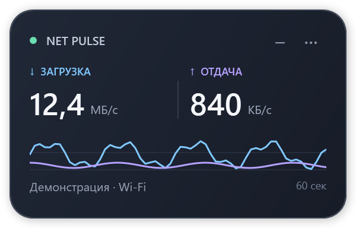
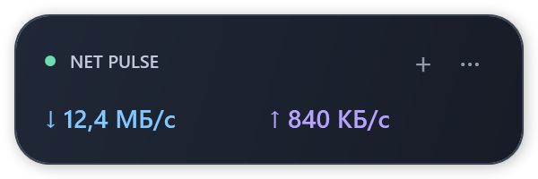

# NetPulse

Компактный монитор скорости сетевого трафика для Windows 11 на C# и WPF.



На изображениях показаны демонстрационные значения.

## Возможности

- Скорость загрузки и отдачи с обновлением раз в секунду.
- График последних 60 измерений с общей шкалой для обоих направлений.
- Обычный виджет 300 × 192 и компактный режим 300 × 100.
- Перетаскивание, привязка к краям экрана и режим поверх остальных окон.
- Значок в трее, сохранение настроек и одна запущенная копия приложения.
- Переключение байт/с и бит/с, автоматический или ручной выбор адаптера.



## Сборка и запуск

Требуется Windows с .NET Framework 4.8. Сборка использует системный компилятор
`csc.exe`; NuGet, Visual Studio и сторонние библиотеки не нужны.

В PowerShell из корня репозитория:

```powershell
.\build.ps1 -Test
```

Затем запустите `dist\NetPulse.exe`. Оставьте `NetPulse.exe.config` рядом с EXE.
Для сборки без тестов выполните `.\build.ps1`.

## Управление

| Действие | Управление |
| --- | --- |
| Переместить окно | Перетащить за фон или заголовок |
| Компактный режим | Кнопка «−» / «+» или двойной щелчок по фону |
| Настройки | Кнопка «···» или правая кнопка мыши |
| Скрыть в трей | Esc или соответствующий пункт меню |
| Вернуть окно | Двойной щелчок по значку в трее или повторный запуск EXE |
| Завершить работу | «Выход» в меню окна/трея или Alt+F4 |

Настройки сохраняются в `NetPulse.settings.xml` рядом с EXE. Выберите папку,
в которую у пользователя есть право записи. Автозапуск не включается.

## Измерение трафика

Приложение читает 64-битные счётчики Windows через `GetIfTable2` и рассчитывает
разность байтов за фактически прошедшее время. Учитываются IPv4, IPv6 и трафик
локальной сети. Собственных сетевых запросов, перехвата пакетов и телеметрии нет.

Автоматический режим суммирует активные физические адаптеры. Виртуальные
интерфейсы VPN не прибавляются повторно. Если физических адаптеров нет,
выбирается один активный виртуальный адаптер с наибольшей скоростью канала.
Конкретный адаптер, включая VPN, можно выбрать вручную.

Единицы десятичные: 1 КБ = 1000 байт, 1 МБ = 1 000 000 байт, 1 байт = 8 бит.
Зелёная точка означает активный адаптер, а не проверенную доступность интернета.
Это монитор текущего трафика всего компьютера, а не тест пропускной способности
и не статистика отдельных программ.

## Исходники и проверки

| Файл | Назначение |
| --- | --- |
| `src/App.cs` | Жизненный цикл, окно, график, меню и трей |
| `src/Widget.xaml` | Разметка интерфейса |
| `src/NetworkMonitor.cs` | Windows API, выбор адаптера и расчёт скоростей |
| `src/Settings.cs` | Чтение и сохранение настроек |
| `tests/Tests.cs` | Проверки счётчиков, переподключения, единиц и настроек |
| `tests/VisualTests.cs` | Загрузка XAML и отрисовка обоих режимов без открытия окна |
| `build.ps1` | Сборка приложения и запуск тестов |

Проверки системных счётчиков требуют хотя бы одного активного сетевого адаптера.
Визуальные тесты сохраняют PNG в `test-output`. Автоматические тесты отрисовки
не заменяют проверку взаимодействия с окном на рабочем столе.

Документация: [GetIfTable2](https://learn.microsoft.com/en-us/windows/win32/api/netioapi/nf-netioapi-getiftable2),
[MIB_IF_ROW2](https://learn.microsoft.com/en-us/windows/win32/api/netioapi/ns-netioapi-mib_if_row2).
